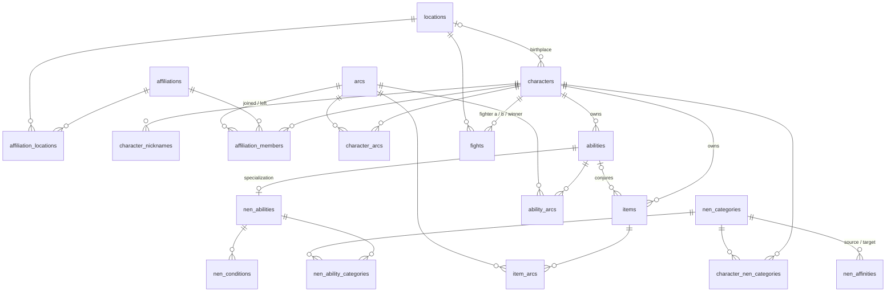

# Database

Hunter × Hunter Nen system, designed in BD1 and translated to English: same 19 tables; 66 constraints (10 CHECK, 29 FK, 19 PK, 8 UNIQUE) after the changes below.

Two deliberate changes from BD1:

- Affiliation membership is marked by arc, not by date. Arcs are the story's only timeline, so filtering by affiliation and arc together needs membership in arc terms.
- `characters.birthplace_id` is optional: the story never says where Leorio, Hisoka or Netero were born.

- Files: `database/schema.sql`, `database/seed.sql`. Requires PostgreSQL ≥ 15 (`UNIQUE NULLS NOT DISTINCT`).
- Local setup: `createdb associacao_hunter && psql -v ON_ERROR_STOP=1 -d associacao_hunter -f database/schema.sql -f database/seed.sql`.
- Derived attributes are computed in queries, not stored: affiliation member count, arc chapter count, membership status (`left_arc_id IS NULL` = active).
- Member during arc X: `joined_arc.start_chapter <= X.start_chapter` and (`left_arc_id IS NULL` or `left_arc.start_chapter >= X.start_chapter`). Inclusive: leaving during an arc still counts as member in it.
- Joined arc ≤ left arc is not a CHECK (it needs `arcs`); the data keeps it.

## Relationships

## BD1 mapping

Primary keys became `id`; foreign keys `<entity>_id`. Columns not listed keep their meaning (`nome` → `name`, `descricao` → `description`, `tipo` → `type`).

| BD1 | Now | Renamed columns |
|---|---|---|
| Local | locations | — |
| Filiacao | affiliations | — |
| Filiacao_Local | affiliation_locations | — |
| Personagem | characters | primeiroNome → first_name, segundoNome → last_name, dataNascimento → birth_date, sexo → sex, estaVivo → is_alive, id_local → birthplace_id |
| Apelido_Personagem | character_nicknames | apelido → nickname |
| Arco | arcs | capituloInicial → start_chapter, capituloFinal → end_chapter |
| Membro_Filiacao | affiliation_members | cargo → role, dataIngresso → joined_arc_id, dataSaida → left_arc_id (date became arc) |
| Personagem_Arco | character_arcs | — |
| Habilidade | abilities | id_personagem → owner_id |
| HabilidadeNen | nen_abilities | id_habilidade → ability_id, tipoHatsu → hatsu_type, custoAura → aura_cost |
| Item | items | ehDeNen → is_nen, id_personagem → owner_id, id_habilidade → conjured_by_id |
| Item_Arco | item_arcs | — |
| Habilidade_Arco | ability_arcs | — |
| CategoriaNen | nen_categories | — |
| Condicao | nen_conditions | id_habilidade → nen_ability_id |
| HabilidadeNen_Categoria | nen_ability_categories | id_habilidade → nen_ability_id, id_categoria → category_id |
| Personagem_CategoriaNen | character_nen_categories | id_categoria → category_id, tipoAfinidade → affinity_type |
| Afinidade_Nen | nen_affinities | id_categoria_origem → source_category_id, id_categoria_destino → target_category_id, percentual → efficiency_percent |
| Combate | fights | id_personagem_a → fighter_a_id, id_personagem_b → fighter_b_id, id_vencedor → winner_id, id_local → location_id, data → fought_on, duracao → duration_minutes |

## Seed

Source: the HxH Fandom wiki (MediaWiki API, English), read in November 2026. 9 characters: Gon, Killua, Kurapika, Leorio, Hisoka, Illumi, Chrollo, Netero, Neferpitou.

| Data | Rule |
|---|---|
| Arcs | The wiki's 7, by chapter. The Succession Contest (340–) is ongoing and includes the expedition |
| Memberships | Recorded up to the end of the Chimera Ant arc (Formigas Quimera), the reference of the licensed hunter seal. One that predates the story starts in the first arc (Exame Hunter), such as Netero's presidency; a death ends one in that arc |
| `character_arcs` | Arcs with a plot section on the character's wiki page, none after their death |
| `item_arcs`, `ability_arcs` | The arc where the item or ability first appears |
| Birthplace | Where the character was raised, per their page; `NULL` when the story doesn't say |
| `nen_affinities` | Nen chart (chapter 108): 80 next to the source on the hexagon, 60 two steps away, 40 opposite; 0 into Specialization unless the source is a Specialist. Categories are inserted in hexagon order, since the sheet lists efficiency by id |
| Names | Abilities, items and nicknames translate the wiki's English names to Portuguese; puns and Japanese terms stay (Jajanken, Bungee Gum, Danchou) |

Closed value lists, kept by convention (a CHECK would change BD1's constraint count):

| Column | Values |
|---|---|
| `locations.type` | Ilha, Montanha, Floresta, Cidade, País, Prédio |
| `nen_abilities.hatsu_type` | Ataque, Controle, Estado ativado, Objeto materializado, Propriedade da aura |
| `nen_conditions.type` | Gatilho (what activates it), Restrição (usage limit), Custo (what it costs), Juramento (vow with a penalty) |
| `nen_abilities.aura_cost` | 1–5, estimated from the wiki's description: 1 light or continuous use, 3 regular strike, 5 extreme cost (life, all future Nen) |

Invented or approximate values:

- Hisoka's birth year (1972); the story gives only June 6.
- Every `aura_cost`: the story gives no figures.
- Fight dates and durations. Gon × Hisoka: July 1999. Gon × Neferpitou: July 2000 (the wiki doesn't date the palace invasion). Chrollo × Hisoka: July 21, 2001 (the wiki's Timeline places it between July 4 and August 7).
- Kurapika is an active Kurta Clan member: the clan ended before the story, so there is no arc for him to leave in.
- A Specialist's efficiency in the other categories follows hexagon distance; the wiki is ambiguous there.

## Known gaps

- `fights` has no arc; death (`is_alive`) has no arc.
- The closed value lists are not enforced by the database.
- Every seeded character has a main Nen category, so the sheet's all-`null` efficiency has no example.
