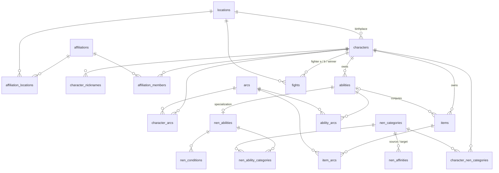

# Database

Hunter × Hunter Nen system, designed in BD1 and translated 1:1 to English: same 19 tables, relationships and 65 constraints (11 CHECK, 27 FK, 19 PK, 8 UNIQUE).

- Files: `database/schema.sql`, `database/seed.sql`. Requires PostgreSQL ≥ 15 (`UNIQUE NULLS NOT DISTINCT`).
- Local setup: `createdb associacao_hunter && psql -v ON_ERROR_STOP=1 -d associacao_hunter -f database/schema.sql -f database/seed.sql`.
- Derived attributes are computed in queries, not stored: affiliation member count, arc chapter count, membership status (`left_on IS NULL` = active).

## Relationships

## BD1 mapping

Primary keys became `id`; foreign keys `<entity>_id`. Columns not listed keep their meaning (`nome` → `name`, `descricao` → `description`, `tipo` → `type`).

| BD1 | Now | Renamed columns |
|---|---|---|
| Local | locations | — |
| Filiacao | affiliations | — |
| Filiacao_Local | affiliation_locations | — |
| Personagem | characters | primeiroNome → first_name, segundoNome → last_name, dataNascimento → birth_date, sexo → sex, estaVivo → is_alive, id_local → birthplace_id |
| Apelido_Personagem | character_nicknames | apelido → nickname |
| Arco | arcs | capituloInicial → start_chapter, capituloFinal → end_chapter |
| Membro_Filiacao | affiliation_members | cargo → role, dataIngresso → joined_on, dataSaida → left_on |
| Personagem_Arco | character_arcs | — |
| Habilidade | abilities | id_personagem → owner_id |
| HabilidadeNen | nen_abilities | id_habilidade → ability_id, tipoHatsu → hatsu_type, custoAura → aura_cost |
| Item | items | ehDeNen → is_nen, id_personagem → owner_id, id_habilidade → conjured_by_id |
| Item_Arco | item_arcs | — |
| Habilidade_Arco | ability_arcs | — |
| CategoriaNen | nen_categories | — |
| Condicao | nen_conditions | id_habilidade → nen_ability_id |
| HabilidadeNen_Categoria | nen_ability_categories | id_habilidade → nen_ability_id, id_categoria → category_id |
| Personagem_CategoriaNen | character_nen_categories | id_categoria → category_id, tipoAfinidade → affinity_type |
| Afinidade_Nen | nen_affinities | id_categoria_origem → source_category_id, id_categoria_destino → target_category_id, percentual → efficiency_percent |
| Combate | fights | id_personagem_a → fighter_a_id, id_personagem_b → fighter_b_id, id_vencedor → winner_id, id_local → location_id, data → fought_on, duracao → duration_minutes |

## Known gaps in the seed

The seed only met BD1's minimums; it will be repopulated from the HxH wiki.

- Invented data: 4 non-canon Nen categories, forced birthplaces (`birthplace_id` is required), fictional dates, "Nen Stitches" assigned to Hisoka (it's Machi's).
- `nen_affinities` has 5 of the 30 pairs among the 6 canon categories.
- Free-text domains (`hatsu_type`, `nen_conditions.type`, `locations.type`) mix concepts; poor for filters.
- `fights` has no arc; death (`is_alive`) has no arc.
- `items.name` is unique per owner only: seed lookups by item name break once two owners share a name.
